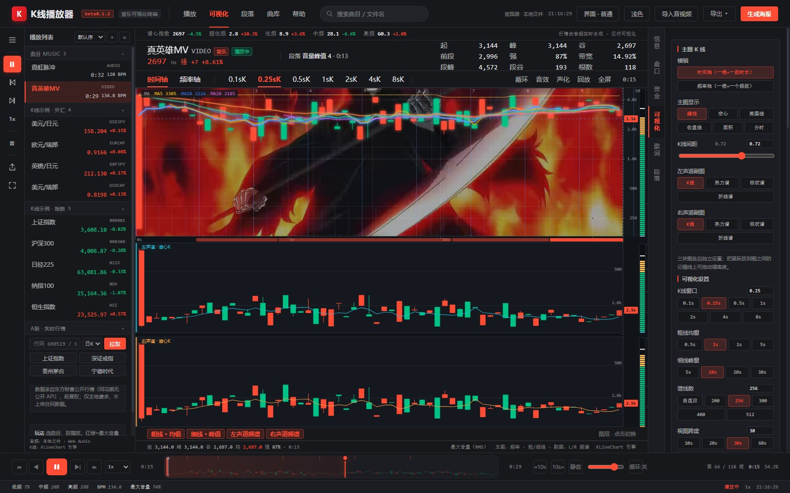
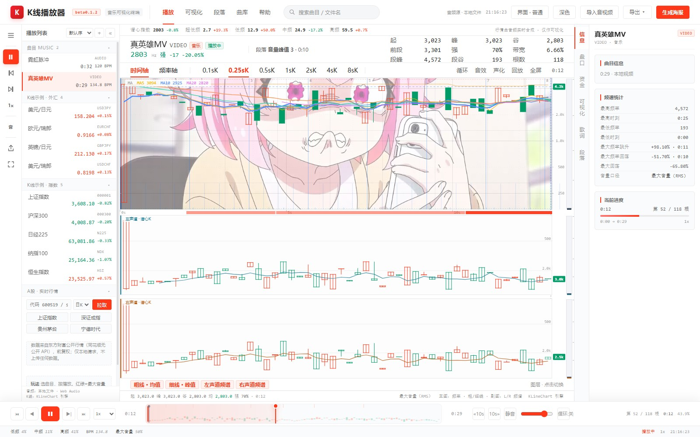
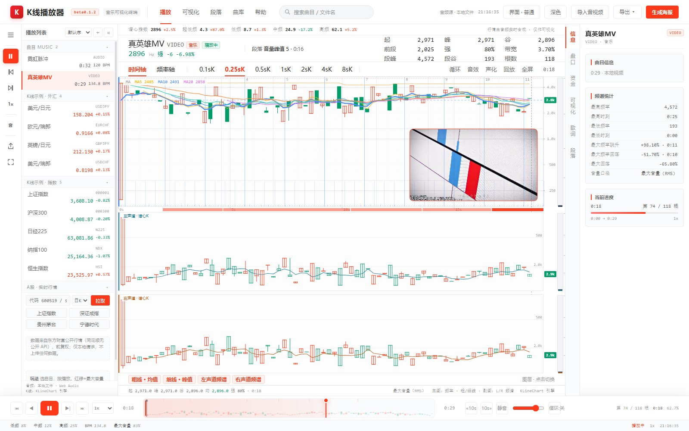
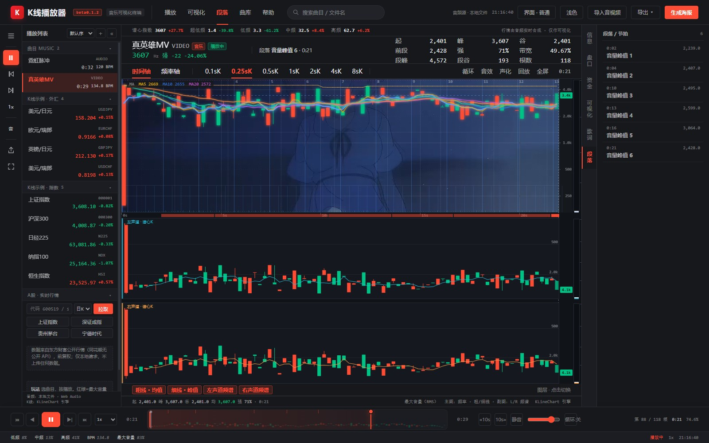
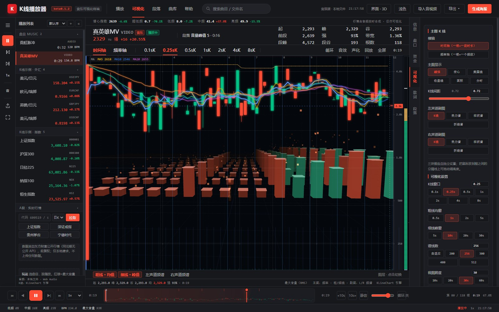
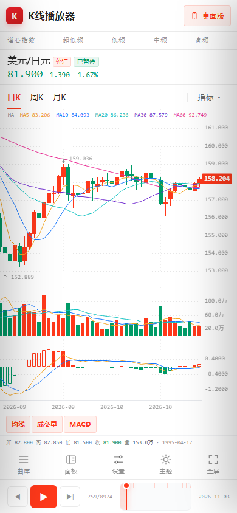

# K线播放器 · 音乐可视化终端

`beta0.1.2`

把一段音乐当成一部 K 线来看：音频在浏览器本地做频谱分析，主图画「频率振幅 K 线」，副图画左右声道各自的滚动频谱，播放进度就是行情推进。


## 下载

[GitHub Releases](https://github.com/ayst-z/kline-player/releases) 提供两个整合包：**标准版 ZIP**（解压后双击 `index.html`）与**单文件版 HTML**（CSS / JS / 数据全部内联，双击即用）。

## 界面预览

> 展示图中的视频画面来自同花顺官方《真英雄》MV，仅用于演示播放器的视频层与图表能力；MV 版权归原权利方所有，不随本项目或安装包分发。



| 浅色 · 视频画面层 | 画中画 · 小窗 |
| --- | --- |
|  |  |

| 深色 · 段落与监看 | 3D 行情墙 |
| --- | --- |
|  |  |

界面外观对齐**同花顺网页版**（`stockpage.10jqka.com.cn`）的浅色行情面板：涨色 `#ff381a`、跌色 `#009b67`、页面底 `#f5f5f5`、分隔线 `#ebebeb`、正文 `rgba(0,0,0,.84)`／次要 `rgba(0,0,0,.6)`；62px 图表头（左：名称 18px + 代码 14px + 现价 + 涨跌/涨跌幅，右：3 列 × 3 行短标签指标网格，列距 24px／行距 4px）；周期页签为纯文本 14px、选中加粗；主图下方一行副图指标页签。这些取值与结构取自该页面渲染后的计算样式，顺带一提：同花顺网页版的 K 线本身也是用 KLineChart 画的。文案全部换成播放器语义。

## 手机模式 / 竖屏

宽度 ≤760px，或竖屏且 ≤900px 时自动进入手机布局；顶栏「手机模式 / 桌面版」可手动切换，并记住选择。桌面端也可以点它强制预览竖屏。

- 单列布局：行情头 → 指数条 → 周期 → 图表 → 副图页签，图表占满剩余高度；隐藏桌面工具轨和画线工具栏。
- 曲库是左抽屉，面板 / 可视化设置是右抽屉，都带遮罩；右抽屉顶部把「信息 / 盘口 / 资金 / 可视化 / 歌词 / 段落」改成横向页签。
- 底部快捷栏：曲库 / 面板 / 设置 / 主题 / 全屏；播放条保留上一根 / 播放 / 下一根、时间与进度，隐藏桌面端的倍速、10 秒和音量扩展。
- 适配 `env(safe-area-inset-*)`：刘海、底部 Home 条不会压住内容；`100dvh` 处理移动浏览器地址栏伸缩。
- `viewport-fit=cover` + 触控目标放大；手机上不再显示画线工具栏，避免挡住 K 线。



## 怎么用

免构建、免依赖安装，**直接双击 `index.html`**（`file://` 即可运行）。手机/平板访问同一份多文件版时自动进入竖屏布局；桌面点顶栏手机图标可预览。

- 导入音频/视频：右上角「导入音视频」，音频支持 mp3 / wav / ogg / m4a / flac / aac，视频支持 mp4 / webm / mov（取其中的音轨做分析，画面可选作背景层）。
- 内置演示：曲目列表第一条「霓虹脉冲」（32 秒 · 120 BPM · 6 段），由代码合成，无需外部素材。
- **拖放**：音频/视频、LRC/SRT/VTT、CSV 直接拖进窗口即可（全屏虚线提示，按类型自动分流）。
- **命令面板**：`Ctrl / ⌘ + K` 搜命令——播放、主题、指标开关、字幕、面板、导出、跳段落都在里面，↑↓ 选择、Enter 执行。
- **右键图表**：从这里播放 / 设为 A 点 / 设为 B 点 / 清除 A-B / 复制时间码 / 复制当前频率 / 导出 PNG。
- K 线示例：曲目列表下半部分是 9 个真实日线片源（美元/日元、欧元/瑞郎、英镑/日元、美元/瑞郎、上证、沪深300、日经225、纳指100、恒生），走 KLineChart 渲染，与音乐模式共用同一套回放交互。

快捷键：`空格` 播放/暂停 · `← →` 单根（`Shift` 十根）· `↑ ↓` 倍速 · `滚轮` 缩放 · `1-9` 跳段落 · `Ctrl/⌘+K` 命令面板 · `S` 字幕区 · `Shift+S` 画面内字幕 · `D` 弹幕 · `M` 音效 · `L` 循环 · `R` 从头 · `F` 全屏 · `T` 深浅主题 · `ESC` 关闭弹窗。

主图下方一行页签是真实开关：K 线示例模式切换 均线 / 成交量 / MACD 副图，音乐模式切换 粗线（均值）/ 细线（峰值）/ 左声道频谱 / 右声道频谱 图层；关掉两条频谱时频率主图自动占满高度。

## 深浅两套主题

顶栏「深色 / 浅色」按钮、快捷键 `T`、或 URL `?theme=dark` 切换；主题写入 `localStorage`。两套令牌覆盖 DOM、音乐画布、KLineChart 样式与导出海报，配色取自同花顺（浅色＝网页版实测值，深色＝客户端看盘配色）。

## 波形条与 A-B 区间

回放条在音乐模式下是一条立体声波形：中线以上为左声道、以下为右声道，取每像素列的 RMS 峰值，只在分析完成 / 尺寸变化 / 换主题时重绘一次。**Shift + 拖拽**框选 A-B 区间 → 自动循环该区间，并在右侧「电平表」卡里给出区间时长、区间平均谱心、区间最大音量；点「清除区间」或按 `T` 旁的按钮取消。

## 视频画面层

导入 mp4 / webm / mov 时，页面会做两件事：用 `decodeAudioData` 解出音轨走原来的分析管线，同时把同一个文件挂到一个隐藏的静音 `<video>` 上（`#videoLayerBox`，`muted + playsInline`，只当帧源）。时钟仍然是 `<audio>`：每帧检查一次偏差，超过 0.35 秒才回拨 `video.currentTime`，播放/暂停/倍速都跟随音频，所以不会出现越跑越歪的漂移。

主图区（频率 K 线那一格）在画完面板底色后、画网格与 K 线之前，把当前视频帧按 cover 等比缩放贴进去，透明度由「画面层透明」滑杆控制（默认 50%，可调到 0 关掉）。副图频谱、电平表、轴标签始终压在画面之上，K 线可读性不受影响；关掉开关或切回非视频片源时图层盒会被隐藏并释放视频元素。

展示图中的 MV 素材为同花顺官方《真英雄》，仅作播放器功能演示，版权归原权利方；播放器本身不附带该 MV，导入自己的 mp4 / webm / mov 即可。

## 3D K 线背景（three.js）

顶栏「界面 · 普通 / 3D」一键切换（`Ctrl+K` 也能搜到）：

- **普通界面**：原来的同花顺浅/深色终端。
- **3D 界面**：只在 **K 线主图背后**铺一层 three.js 场景——8×20 的数据塔阵随频段能量起伏（能量开 0.55 次幂，小信号也看得见），涨红跌绿；地面透视网格、指数雾、缓慢横移与推进的相机；每座塔顶有发光描边，地面网格随节拍脉冲、雾密度随音量呼吸；画布切透明、3D 画布只覆盖主图（不含副图与右侧轴）。
- 场景按 33ms 节流，只在 3D 模式运行；切回普通界面立即停止并恢复主题。
- 另外保留「图层 → 3D 行情墙」：普通界面里只给主图垫一层 2D 透视墙，适合不想换整个界面时用。

## 真实 K 线（A 股）

侧栏「A股 · 实时行情」输入 6 位代码（可加 `sh`/`sz` 前缀）或点预设，选日/周/月 K，即可把**真实行情**拉进同一套回放与指标界面：

- 数据源：**东方财富公开行情**（`push2his.eastmoney.com`），JSONP 直连，不需要本地服务、不受 `file://` 的 CORS 限制；日 K 默认 420 根、前复权（`fqt=1`）。
- 说明：**同花顺没有公开 API**（iFinD 是付费授权，网页端接口未公开且有反爬与 ToS 限制），所以这里用同一项目既有的东方财富数据源，而不是抓同花顺。
- 拉进来的行情按「本地 K 线」进列表，MA / MACD / 成交量副图 / 十字光标 / 缩放 / 导出 / 生成海报全部直接可用。
- 只做本地请求，不上传任何数据；断网或代码不存在会给出失败提示。
- **平滑回放**：最后一段 K 线不是整根跳出，而是随播放头在 open→close 之间逐帧生长（高/低/量同步插值），到边界才落定成真实值；暂停立即定格。
- **画线工具**：图表左侧竖排工具条——水平线 / 垂直线 / 趋势线 / 射线 / 斐波那契；点两下成线（水平/垂直一下即可），按代码+周期分别存本地，切回来自动重画；`⌫` 清除，`Esc` 退出。
- **播放位置进度线**：市场模式下播放头处有一条橙色虚线随播放移动；**4 秒无操作**后图表用 420ms 缓动滚回播放位置（不是瞬移；滚轮/拖动/按键都会重置计时）。
- **自由浏览 / 回放**：真实行情默认「自由浏览」——整段数据一次载入，滚轮缩放、拖动平移、十字光标都不被打断；点顶栏「回放」才切换成随播放逐根揭示历史（适合当影片看）。日K/周K/月K 随时切换（420 根日线聚合成 90 根周线）。
- **声化**：顶栏「声化」把每根 K 线合成一个音——涨跌映射到 A 小调五声音阶两个八度、成交量映射到音量，大幅波动加五度泛音；开启后回放速度自动压到 8 根/秒，真实行情会自动按「整段约 45 秒」配速。

## 横轴、分图与显示种类

- **加载进度**：顶部一条 3px 进度条 + 底部居中的百分比气泡；「读取音频 → 分析音频」分段提示，分析阶段的百分比来自 Worker 的实时回传，结束自动消失。
- **两种横轴**：主图可以在「时间轴 / 频率轴」之间切换（图表上方页签，或设置面板「横轴」）。时间轴下一根 K 线是一段时间的谱心（单位 Hz）；频率轴下一根 K 线是**一个频段**在聚合窗（2s/5s/10s/30s/全曲）里的能量（单位 %），横轴从左到右低频→高频。频率轴的纵轴按 98 分位做归一化并取 0.55 次幂，能量偏小的频段也看得清，不会挤成一条线。频率轴按 **50ms 档实时解算**：直接用分析帧在滑动窗口内算每根 K 线的开高低收，帧一前进就重算，右沿不会停在预聚合列（0.25s）的边界上。
- **显示种类**：主图可选蜡烛 / 空心 / 美国线 / 收盘线 / 面积 / **分时**，K 线间距 0.25–0.95 可调；K 线示例模式同步切换 KLineChart 的蜡烛类型。
- **分时图**：收盘线 + 黄色均价线（从曲首展开的累计均值）+ 灰色「昨收」虚线（全曲均值）+ 线下红绿填充 + 底部量能柱；切到分时后 MA / EMA / BOLL / 粗细线自动让位，图例改显示「分时 · 均价 · 昨收」。
- **三块图各自设置**：主图、左声道副图、右声道副图互不影响。副图默认也是 **K 线**（该声道谱心随时间的 OHLC），另可选 热力谱 / 柱状谱 / 折线谱。
- **拖动分割线**：主图与副图之间、左副图与右副图之间的分隔线都能直接拖，高度比例写入 `localStorage`。
- **谱线自适应**：谱线条数按画布宽度自动取 120–512 条（紧凑密度约 3.6px/条），新出现的柱子有 0.3s「生长 + 淡入」，不会硬闪。
- **五条曲线**：主图叠加 MA5 / MA10 / MA20 三条均线（「指标」里可关），加上粗线（均值谱心）与细线（峰值谱心）共 5 条曲线；图例固定在图表左上角，跟随十字光标显示当前值。
- **副图读数**：两个声道副图左上角标出「左/右声道 · 谱心K」，右侧贴最新一根的数值签，并有一条同色收盘均线把零散的小实体串成趋势；副图带 125/500/2k/8k Hz 参考线。
- **进度条也是 K 线**：回放条上的迷你 K 线跨整首曲（音乐模式=谱心 OHLC，市场模式=价格 OHLC），已播放段满色、未播放段淡显，播放头是虚线标记，配合 A-B 区间框选。
- **自定义数值**：K线窗口、谱线数、视图跨度、K线间距都可直接输入数值；谱线数还有「自适应」档，按画布宽度自动取 96–512 条。
- **播放器**：±10 秒、静音、音量滑杆、循环三档（关 / 单曲 / 列表，`L` 键循环）、`Home` / `End` 跳首尾。
- **右侧价格轴**：主图右侧有独立底色带 + 分隔线，Hz / 能量刻度与最新值签都排在这条轴里，不压 K 线。
- **段落色带可点**：点主图下方那条段落色带直接跳到该段起点，鼠标移上去变手型；拖分隔线只保留色带上下两条细边，互不干扰。
- **盘口深度条**：五档下面加一条按能量占比分配的深度条，五段合起来正好 100%。
- **顶部指数条**：谱心指数 + 超低频 / 低频 / 中频 / 高频四档，实时显示当前值与相对全曲均值的涨跌幅（红涨绿跌），像行情终端的指数带。
- **资金流向面板**：右栏「资金」页，四档（超大单 / 大单 / 中单 / 小单 = 四个频段）的当前占比相对全曲均值的净流入，红绿双向条 + 主力（超大单+大单）净流入汇总。
- **不越界**：纵轴上下限遇到更大的值会**立刻抬高**（回落时才平滑），并留 3px 内边距；频率轴的纵轴按真实最大值留 5% 头部，再密的高能量频段也不会顶到边框外。
- **频段自适应合并**：频率轴一屏超过 150 根时自动把相邻频段合并，柱子保持足够宽度。

## 指标与节拍

- **主图叠加**：MA5/10/20（音乐模式）、**EMA 12/26**、**布林带 BOLL**。BOLL 的 N 与 K 可调（5–120 / 0.5–3），在对数频率空间算均值与标准差，所以 ±Kσ 在屏幕上左右对称；数组按曲目缓存，参数变了才重算。
- **节拍网格**：20ms 能量包络自相关取候选周期 → 5ms 包络梳状打分（on-beat − 0.65×反拍）定相位 → 小节线按 4/4 全高绘制并编号，弱拍线从 80% 高度起，底部另有一条**真实 onset 瞬态刻度轨**（约 3000 个以内峰值），网格给秩序、刻度给真实。
- **人工对齐**：BPM 与相位都能覆盖（设置 → 节拍 BPM / 相位，BPM 填 0 = 自动），「自动」一键复位；顶栏显示的 BPM 是生效值（含覆盖）。
- 指标与节拍都只走一遍「窗口量化 + 单次重绘」的绘制路径：EMA + BOLL 全开实测 **0.83 ms/帧**（关闭 0.75 ms）。

## 字幕（逐字）

设置面板「字幕」一行：

- **AI 逐字听写**：把当前曲目音频 POST 到本机字幕桥（`tools/ai_subtitles_server.py`，只监听 `127.0.0.1:8765`，不上传、不留存），faster-whisper 返回**词级时间戳**（`word_timestamps=True`），字幕按字点亮；
- **导入 LRC / SRT / VTT**：自动去 BOM、CRLF 与 HTML 标签；
- **±0.5s 偏移**、**清除**、总开关（设置 → 图层里的「字幕」）；
- 字幕条贴在图表底部居中，深色主题自动换底；无字幕行时自动隐藏。

字幕有三种呈现，互相独立：

- **字幕区（嵌入式）**：**进度条上方的全宽独立区域**，三行歌词（上一句 / 当前句 / 下一句），当前句逐字点亮，点任意一行跳到该句，可收起（画布自动重排）。窗口有焦点时自动使用它。
- **悬浮字幕条**：窗口失焦 / 页面不可见时自动切到底部居中的悬浮条；也可在字幕区头部「模式·自动」按钮或设置里锁定「内嵌 / 悬浮」。将来做 EXE 小窗时沿用同一套，接口是 `KLINE_APP.setSubView('auto'|'dock'|'float')`。
- **画面内字幕**：画布浮层，用于导出与录屏（`Shift + S` 或字幕区「画面内」按钮）。

快捷键：`S` 收起/展开字幕区，`Shift + S` 画面内字幕。

启动字幕桥：`python tools/ai_subtitles_server.py --model-dir <whisper 模型目录>`（需要 `faster-whisper` 与 ffmpeg）。

**内置识别（推荐）**：`node tools/stt_local.js <16k.wav> [out.json] [zh]` —— 本机 SenseVoice ONNX + sherpa 运行时都放在 `tools/` 下（`tools/models/` 与 `tools/stt/node_modules/` 已 gitignore），不联网、不起服务；输出播放器可直接导入的 `subs.json` 与同名 `.lrc`。18 秒音频实测约 0.5 s 出结果。

## 导出

顶栏「导出 ▾」两档：

- **导出当前图 PNG** — 音乐模式把画布按当前状态直接存成 PNG；K 线示例模式走 KLineChart 的 `getConvertPictureUrl`。想要带标题栏/统计的成品图，用右边的「生成海报」（支持 1×/2×/3× 倍率）。
- **录制视频 WebM** — `canvas.captureStream(30)` + Web Audio 的 `MediaStreamDestination` 把音轨混进同一路流，`MediaRecorder` 实时录制当前曲目（从 0 开始），顶栏出现录制条，点一下停止并自动下载 `.webm`（含声音）。暂停播放录制也会暂停，录制期间请保持标签页在前台。需要 Chrome / Edge。

## 长标题滚动

标题超出可用宽度时自动进入滚动展示：顶栏曲名与右栏「曲目信息」标题按溢出距离匀速左右往返；侧边栏条目默认不动，鼠标悬停才滚动。短标题保持静态，不做多余动画（`prefers-reduced-motion` 下关闭）。

## 视频画面适配

导入视频后可切「铺满裁切 / 完整显示 / 拉伸铺满」三种适配，窗口缩放时自动跟随；播放时视频以音频时钟为准，偏差小用 ±6% 的播放速率微调，超过 0.6 秒才重新定位（带 1.8 秒冷却），避免频繁 seek 造成的卡顿。

## 渲染性能

| 场景（256 谱线 / 30s 视图） | 优化前 | 优化后 |
| --- | --- | --- |
| 单帧重绘（含光栅化同步） | 14.8 ms | 2.84 ms |
| 频率 K 线序列（4 分钟曲） | 28.3 ms | 1.2 ms |
| 频谱列构建（4 分钟曲，L+R） | 171.8 ms（两次） | 71.8 ms（一趟） |
| 导入分析（4 分钟曲） | 1426 ms 阻塞主线程 | 分片执行，每片约 55ms 让出主线程并显示进度 |

关键做法：频谱副图改为**离屏缓存 + 半屏分块失效**（滚动时只重绘新进入的块，其余帧只做一次 `drawImage` 加播放头遮罩）；窗口聚合用单调游标推进，不再每列全帧扫描；左右声道在同一趟里算完；电平表互相关节流到约 8 次/秒。

## 借鉴的开源项目（仅思路，未引入其代码）

- **wavesurfer.js（BSD-3-Clause）**：波形条、Regions 区间、Minimap 概览 → 本项目的立体声波形条与 A-B 区间循环。
- **Tone.js Visualizer（MIT）**：Meter / FFT / Waveform 工具的分层思路 → 电平表的平滑包络与峰值保持列。
- **projectM / Milkdrop（LGPL）**：节拍驱动的视觉脉冲 → BPM 节拍网格与播放头拍点闪光。
- **KLineChart（Apache-2.0）**：K 线骨架，市场示例与同花顺网页版用的是同一个库。

后续重构计划：波形与区间逻辑独立成模块，便于替换为实时 `AnalyserNode` 输入。

## 音乐可视化的映射规则

| 面板 | 数据来源 | 语义 |
| --- | --- | --- |
| 主图 K 线 | 每根 = 一个时间窗（0.5/1/2/4/8 秒） | 开=窗内首个谱心、收=窗内平均谱心、高/低=窗内峰谷（单位 Hz）；阳线空心、阴线实心，与同花顺习惯一致，可在设置里改回实心 |
| 粗线 | 平均谱心窗（0.5/1/2/5 秒） | 时间段平均幅值 |
| 细线 | 峰值谱心窗（5/10/20/30 秒） | 时间段最大幅值 |
| 副图 ×2 | 左声道 / 右声道，各自独立处理，每声道 200/256/300 条谱线 | 滚动频谱 + 该声道响度包络 |
| 电平表 | L / R / MASTER 三列 + 右侧信息栏 | 平滑电平、峰值保持、谱心、瞬态、左右互相关 |
| 频段盘口 | 5 档频段（超低频…超高频）的当前能量占比 + 峰值线 | 借同花顺「五档盘口」的位置，数据换成频谱 |
| 逐帧明细 | 最近 24 个 FFT 帧的时间 / 谱心 / 音量 / 升降 | 借「逐笔明细」的位置；FFT 步长小于 1 秒时时间带一位小数 |
| 红/绿 | 该声道最大音量（RMS）相对上一列的升降 | 不是开收比较 |

分析管线：`AudioContext.decodeAudioData` → 立体声分声道 → 2048 点 FFT（Hann 窗，0.1 秒步长）→ 40–12000 Hz 对数 512 频带 → 逐带 p98 归一化 + 指数平滑 → 谱心（加权频率）与 RMS。播放时钟用 `<audio>` 元素，`timeupdate` 兜底，所以后台标签页也不会跑偏。

## 设置项

右侧「可视化」页：K 线窗口、粗线均窗、细线峰窗、谱线数（L/R 各）、视图跨度、平滑、音量、重新分析音频；「样式」页另有主题、涨跌色、密度、海报导出倍率、频率/振幅刻度、频谱亮度、画面层透明，以及节拍网格 / 高低水位线 / 声道包络 / 发光 / 视频画面层四个开关。所有设置写入 `localStorage`，刷新后保留；也可用 URL 参数覆盖，例如 `?id=demo-neon&window=2&bands=256&view=30&t=12&play=1`（可用：`id / window / thick / thin / bands / view / t / i / play / speed / danmaku / sound / panel / nostart`）。

## 自检

```bash
node tests/run.js             # 11 项断言：启动 / 主题 / 导入分析 / Worker / 节拍 / 字幕 / 双形态 / 指标 / 覆盖 / 异常
PORT=9250 node tests/run.js   # 换端口
CHROME="D:/Chrome/chrome.exe" node tests/run.js
```

脚本自带一段 120 BPM 的合成点击轨和一份 LRC，用 headless Chrome 跑完即关，**不需要任何版权素材**。退出码非 0 表示有断言失败。

## 目录

```
index.html          界面结构（同花顺浅色面板骨架）
styles.css          浅色主题 + 电平表样式
app.js              播放器主逻辑（分析 / 绘制 / 同步 / UI）
vendor/             KLineChart v9.8.12 UMD + Apache-2.0 许可
data/               library.js 片源表 · 9 个日线数据 · 内置演示音频 · 曲目库
audio/demo.mp3      演示音频源文件
tools/build_data.py 东方财富日线 → data/*.js
tools/ai_subtitles_server.py  本地 Whisper 字幕桥（见下）
tests/run.js        回归自检（合成音频 + headless Chrome）
```

## 分析性能

频谱分析跑在 **Web Worker** 里（`file://` 下用 Blob URL 起线程）：解码后的声道数据按 2 秒一块传入 Worker，块间让出主线程。4 分钟曲目实测，主线程长任务从 **9 个（8×55ms + 1×402ms）降到 1 个（79ms）**，最大卡顿 **404ms → 82ms**。Worker 起不来时自动回落到原来的主线程分片分析。

## 隐私与许可

- 音频只在浏览器本地解码与分析，**不上传任何数据**；导入的曲目只存在于当前页面会话。
- KLineChart（Apache-2.0）用于 K 线示例片源的渲染，音乐模式为自绘 Canvas。
- 日线数据来自东方财富公开行情接口，用 `tools/build_data.py` 离线抓取；外汇没有真实成交量，图中「量能」按振幅估算并在界面标注「按振幅估算」。
- 灵感来自 B 站近期的 K 线玩具（久留美模拟器、K 线跑酷、PerfTicker 等）；布局只是仿同花顺 Web 端的视觉风格，**与同花顺官方无关**。README 展示图中使用了同花顺官方《真英雄》MV 的截图，仅作播放器功能演示，版权归原权利方，不随安装包分发。
- `tools/ai_subtitles_server.py` 是可选的本地字幕桥（faster-whisper，只监听 `127.0.0.1:8765`，临时文件用完即删），**界面尚未接线**。

## 反馈与支持

有问题、想加功能、或者发现哪里显示不对，直接到 [Issues](https://github.com/ayst-z/kline-player/issues) 留言，我会持续更新。

如果这个项目帮到了你，可以请作者喝杯咖啡：

<p align="center"></p>
<p align="center">卧龙凤雏 的赞赏码</p>

## 许可证

本项目代码以 MIT 协议开源（见 [LICENSE](LICENSE)）。内置的 KLineChart v9.8.12 为 Apache-2.0；日线数据抓取自东方财富公开接口，仅作演示。第三方组件与数据来源详见 [docs/THIRD_PARTY.md](docs/THIRD_PARTY.md)。

本项目为娱乐/技术演示，K 线示例数据不构成任何投资建议。
